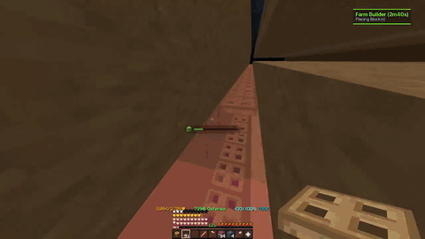
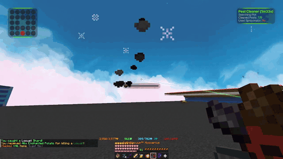
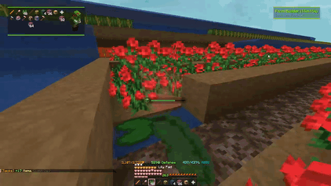
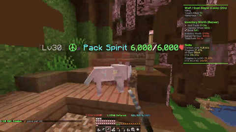
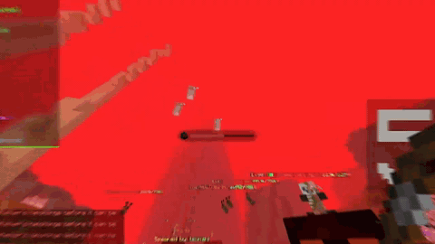
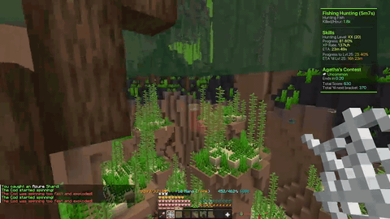
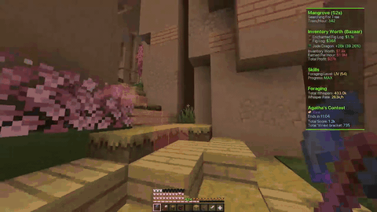
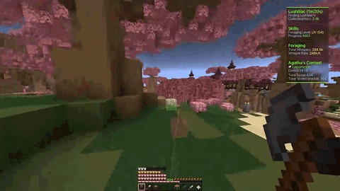
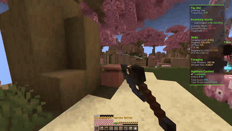

  
  
  
  
    
  
  

  <h1>Taunahi Client</h1>
  
<b>The Ultimate Automated Utility Mod for Hypixel Skyblock</b>

  
  
    

  

    <a href="#-core-systems">Core Systems</a> •
    <a href="#-skill-modules">Skill Modules</a> •
    <a href="#-installation--setup">Installation</a>
  

---

## 📖 Overview

> **Taunahi** is an industry-leading utility client designed to fully automate Hypixel Skyblock grinding with unmatched precision. From complex pathfinding and humanized movement to the proprietary Hydra Anti-Staff system, Taunahi handles the repetitive tasks so you can focus on progression.

## 🛡️ Core Systems & Protection

Taunahi isn't just about automation; it's about staying under the radar. Our core modules ensure your sessions are safe, stable, and highly profitable.

| Feature | Description | Status |
| :--- | :--- | :---: |
| 👮 **Hydra Anti-Staff** | Advanced detection system with hyper-realistic responses and instant Discord alerts. Unmatched safety. | ✅ |
| 👀 **Humanized Movement** | Movements and rotations based on real mouse sensitivity to bypass server-side simulated movement checks. | ✅ |
| 💎 **Failsafes** | Handles hub switches, disconnects, server reboots, and block-stuck situations effortlessly. | ✅ |
| 😴 **Dynamic Rest** | Simulates a lifelike sleep cycle to keep your playtime looking like a legitimate human schedule. | ✅ |

---

## 🎥 In-Action Showcase

See Taunahi's flawless pathfinding and automation in action.

<b>🌾 Farming & Garden Showcase</b>

 

  
  
  

<b>⚔️ Combat & Slayers Showcase</b>

 

  
  
  

<b>🌲 Foraging Showcase</b>

 

  
  
  

---

## 🎯 Skill Modules

Taunahi features hyper-optimized scripts for nearly every skill and task in the game.

### 🌾 Farming (Garden)
Our Garden scripts adapt to both basic and advanced farm designs with seamless pathfinding.
- **Warts & Crops:** Realistic automation with zero downtime.
- **Echo Script:** Mimics farming paths for *any* custom farm design outside of standard presets.
- **Pests & Visitors:** Automatically clears pests (sprays/repellents) and handles visitors between rewarps for maximum profit.
- **Farm Builders:** Automates the physical building of required farm layouts.

### ⚔️ Combat & Slayers
Maximize combat XP and hourly rates with intelligent auto-walkers and combat scripts.
- **Ghosts:** Ultra-profitable script (~45m/hr) optimized for end-game gear.
- **Slayers:** Fully AFK scripts for Crypt/Rev, Wolf/Sven, and Spider/Tara slayers.
- **Zealot Melee:** Smooth pathfinder that hunts Zealots in the Dragon's Nest/Bruiser hideout.

### 🌲 Foraging & 🎣 Fishing
* **Foraging:** Supports standard Park autowalking, Hub tree clearing, and advanced Galatea routes (Fig, Lushlilac, Mangrove) utilizing jump boost and scaffolding.
* **Fishing:** Includes *Quick Fishing* (anti-AFK, auto-kill), *Location Fishing* (custom pathfinding routes), and *Worm Fishing* (Solo/Party Loot Share mode).

---

## ⚙️ Installation & Setup

**Requirements:** Minecraft **26.2**, [Fabric Loader](https://fabricmc.net/use/installer/) and [Fabric API](https://modrinth.com/mod/fabric-api) for 26.2.

1. Install **Fabric Loader** for Minecraft **26.2** using the Fabric installer.
2. Download **Fabric API** for 26.2 and the latest Taunahi `.jar` from the [**Releases**](https://github.com/TaunahiMacro/taunahi-skyblock/releases) page.
3. Put both `.jar` files into your `.minecraft/mods` folder.
4. Launch Minecraft with the **Fabric 26.2** profile.
5. **Enjoy** your fully automated Skyblock experience!
